  

  Sou estudante EAD e apaixonado por tecnologia. 
  Construo produtos em que a <b>IA</b> conversa com a pessoa — com criatividade, fluidez e olho no detalhe. ✦

  
  
  
  
  
  
  
  

---

### ✦ Projetos em destaque

<table>
  <tr>
    <td width="33%" valign="top">
      <h4>🌉 <a href="https://github.com/NovaDev27/ponte">Ponte</a></h4>
      App para estudantes planejarem o intercâmbio sem perder dinheiro no câmbio. Reúne comparador, orçamento por cidade, checklist, assistente com IA e uma versão para relógio Wear OS.
        
      <code>Expo</code> <code>React Native</code> <code>Kotlin</code> <code>Groq</code>
    </td>
    <td width="33%" valign="top">
      <h4>🪐 Toogle · privado</h4>
      Assistente pessoal por voz no relógio, a Aeri. Cuida de tarefas, lembretes, notas e do controle de gastos. Os dados ficam num banco SQLite no computador, e a IA não inventa valores.
        
      <code>Python</code> <code>SQLite</code> <code>Groq</code>
    </td>
    <td width="33%" valign="top">
      <h4>🌙 KŌHĪRA · privado</h4>
      Estúdio de escrita literária com IA, estética lo-fi japonesa e cinco idiomas. <i>Onde o silêncio vira narrativa.</i>
        
      <code>React</code> <code>Supabase</code> <code>Gemini</code> <code>shadcn/ui</code>
    </td>
  </tr>
</table>

### 🧭 Agora

- 🔨 Validando a **Ponte** com usuários reais
- ☁️ Começando o **Bits**, um computador de IA na nuvem: conecta as IAs que você já usa, importa o histórico e aprende com uma memória em Markdown, no estilo do Obsidian
- 📊 Estudando SQL e análise de dados, num projeto próprio que compara cripto com o CDI
- 🌱 Aberto a estágio em dados e a trocar ideia sobre IA e produto

  ✦ feito com vibe coding · Brasil ✦

