  

  Estudante EAD apaixonado por tecnologia. Construo produtos com <b>IA</b> no centro —
  com criatividade, fluidez e muito foco no detalhe. ✦

  
  
  
  
  
  
  
  

---

### ✦ Projetos em destaque

<table>
  <tr>
    <td width="33%" valign="top">
      <h4>🪐 <a href="https://github.com/NovaDev27/nexora">NEXORA</a></h4>
      IA conversacional com personalidade e a companheira <b>Lume</b>. Streaming, 4 modos, camada de provedores com fallback e isolamento por sessão.
        
      <code>React</code> <code>Fastify</code> <code>Zod</code> <code>SSE</code>
    </td>
    <td width="33%" valign="top">
      <h4>🌙 <a href="https://github.com/NovaDev27/K-h-ra-">KŌHĪRA</a></h4>
      Estúdio de escrita literária assistido por IA, com estética lo-fi japonesa. <i>Onde o silêncio vira narrativa.</i>
        
      <code>React</code> <code>Firebase</code> <code>Groq</code> <code>shadcn/ui</code>
    </td>
    <td width="33%" valign="top">
      <h4>🌉 Ponte · privado</h4>
      App para estudantes planejarem o intercâmbio sem perder dinheiro no câmbio: comparador, orçamento por cidade, checklist e assistente com IA.
        
      <code>Expo</code> <code>React Native</code> <code>Groq</code>
    </td>
  </tr>
</table>

### 🧭 Agora

- 🔨 Evoluindo o **NEXORA** rumo a um provedor de IA real e um app desktop
- 📚 Estudando arquitetura, segurança e testes para produtos com IA
- 🌱 Aberto a trocar ideia sobre IA, produto e design de interfaces

  ✦ feito com vibe coding · Brasil ✦

